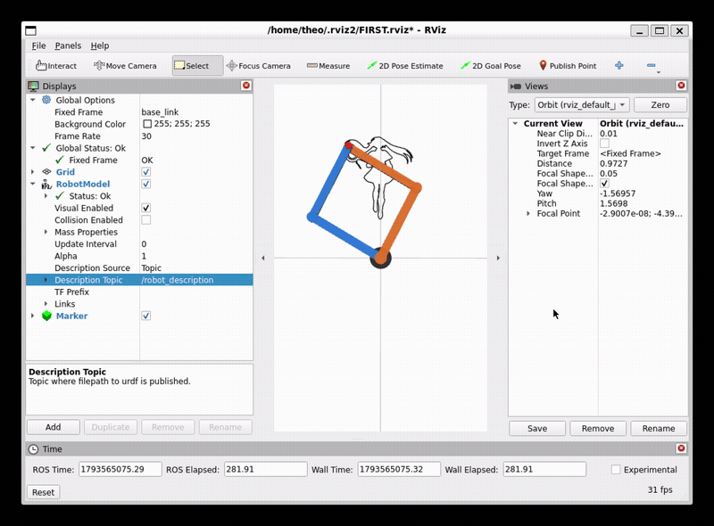

# 2-DOF Planar Robotic Drawing Arm — ROS 2 & URDF Digital Twin


A ROS 2 digital twin and analytical Inverse Kinematics (IK) pipeline for a **dual-chain 2-DOF planar robotic drawing arm**. This project ingests continuous single-line 2D trajectories generated by our upstream **Continuous One-Line Generative Art Pipeline**, scales and maps them onto a physical A4 drawing workspace, solves closed-form joint trajectories, and animates a custom URDF robot model at **$50\text{ Hz}$** in **RViz2** with real-time end-effector ink trail rendering.

<p align="center">
  
</p>

---

## System Architecture & Upstream Pipeline

This repository forms the **Robotics & Digital Twin** stage of a multi-part generative art and control engineering pipeline:

1. **Upstream Path Generation (Continuous One-Line Generative Art Pipeline):**
   * Converts input artwork into a single unbroken continuous path (`frieren_path.npy`) using medial axis skeletonization, Minimum Spanning Tree (MST) bridging, and Chinese Postman Eulerian circuits in `NetworkX`.
   * Smooths raw pixel contours via Discrete Fourier Transform (DFT) epicycles with regression-tuned tracing parameters.
2. **Workspace Mapping & Analytical Inverse Kinematics (`ik_solver.py`):**
   * Normalizes and scales the 2D path coordinates to fit an **A4 landscape sheet ($297.0 \times 210.0\text{ mm}$)** with a $10.0\text{ mm}$ border margin and an $80.0\text{ mm}$ Y-axis offset in front of the robot base.
   * Computes exact closed-form joint angles $(\theta_1, \theta_2)$ for a symmetric two-link planar arm ($L_1 = 180.0\text{ mm}, L_2 = 180.0\text{ mm}$) and verifies numerical precision via Forward Kinematics (FK).
3. **ROS 2 Real-Time Control & Visualization (`arm_publisher.py` & `robot_arm.urdf`):**
   * Streams 4-joint mirrored states at **$50\text{ Hz}$** over `/joint_states` (`sensor_msgs/msg/JointState`) and computes live Forward Kinematics to render a persistent $2\text{ mm}$ ink trail (`visualization_msgs/msg/Marker`) on `/pen_trail`.

---

## Mathematical Formulation (`ik_solver.py`)

### 1. Workspace Normalization & Aspect-Ratio Preserving Scaling
Given raw input coordinates $(x_{\text{raw}}, y_{\text{raw}}) \in \mathbb{R}^{N \times 2}$ loaded from `frieren_path.npy`, coordinates are first shifted to the positive quadrant:

$$x_{\text{norm}} = x_{\text{raw}} - \min(x_{\text{raw}}), \quad y_{\text{norm}} = y_{\text{raw}} - \min(y_{\text{raw}})$$

To fit within an A4 sheet ($W_{\text{paper}} = 297.0\text{ mm}, H_{\text{paper}} = 210.0\text{ mm}$) with uniform border $b = 10.0\text{ mm}$, the isotropic scale factor $s$ is computed as:

$$s = \min\left(\frac{W_{\text{paper}} - 2b}{\max(x_{\text{norm}})}, \frac{H_{\text{paper}} - 2b}{\max(y_{\text{norm}})}\right)$$

The scaled coordinates are centered horizontally around the origin ($x = 0$) and pushed forward along the Y-axis by $d_{\text{space}} = 80.0\text{ mm}$ plus the border $b = 10.0\text{ mm}$ to avoid the base singularity and keep the trajectory inside the manipulator's dexterous workspace:

$$x = s \cdot x_{\text{norm}} - \frac{\max(s \cdot x_{\text{norm}})}{2}, \quad y = s \cdot y_{\text{norm}} + b + d_{\text{space}}$$

### 2. Analytical Inverse Kinematics
For a planar 2R manipulator with equal link lengths $L_1 = 180.0\text{ mm}$ and $L_2 = 180.0\text{ mm}$ and radial target distance $r = \sqrt{x^2 + y^2}$:

* **Elbow Angle ($\theta_2$)** via the **Law of Cosines**:
  $$\cos(\theta_2) = \frac{x^2 + y^2 - L_1^2 - L_2^2}{2 L_1 L_2}, \quad \theta_2 = \arccos\left(\text{clip}(\cos\theta_2, -1.0, 1.0)\right)$$

* **Shoulder Angle ($\theta_1$)** via the **Law of Sines** and quadrant-aware `arctan2`:
  $$\sin(\phi) = \frac{L_2 \sin(\theta_2)}{r}, \quad \theta_1 = \text{atan2}(y, x) - \arcsin\left(\text{clip}(\sin\phi, -1.0, 1.0)\right)$$

* **Mirrored Dual-Chain Trajectory Matrix:**
  To drive both the right (orange) and left (blue) kinematic chains simultaneously so their end-effectors meet at the shared pen tip, `ik_solver.py` exports an $N \times 4$ array to `trajectory_angles.npy`:
  $$\mathbf{q}_k = \begin{bmatrix} \theta_1 & \theta_2 & \theta_1 + \theta_2 & -\theta_2 \end{bmatrix}^T$$

* **Forward Kinematics Verification:**
  Every solved waypoint is verified against the analytical FK equations:
  $$x_{\text{FK}} = L_1 \cos(\theta_1) + L_2 \cos(\theta_1 + \theta_2), \quad y_{\text{FK}} = L_1 \sin(\theta_1) + L_2 \sin(\theta_1 + \theta_2)$$
  confirming machine-precision accuracy ($\max \|\mathbf{p} - \mathbf{p}_{\text{FK}}\|_2 < 10^{-13}\text{ mm}$).

---

## Detailed Breakdown of `arm_publisher.py`

`arm_publisher.py` implements the `PlanarArmPublisher` ROS 2 node (`planar_arm_publisher`) using `rclpy`. It acts as both the trajectory controller for the URDF model and the real-time ink-rendering engine for RViz2.

### 1. Node Initialization & Trajectory Loading
* **ROS 2 Publishers:**
  * `/joint_states` (`sensor_msgs/msg/JointState`, queue size `10`): Feeds time-stamped joint positions to `robot_state_publisher`, which computes the 3D TF2 transforms for all links in `robot_arm.urdf`.
  * `/pen_trail` (`visualization_msgs/msg/Marker`, queue size `10`): Streams the cumulative 3D geometry of the drawn artwork to RViz2.
* **Pre-Computed Trajectory Buffer:**
  * Loads `trajectory_angles.npy` into memory on startup and logs the total number of waypoints (`self.num_points`).
  * Includes fail-safe error handling (`FileNotFoundError`) that alerts the user to run `ik_solver.py` first and cleanly exits if the trajectory binary is missing.
* **Control Loop Timer:**
  * Initializes a deterministic ROS 2 timer with `timer_period = 0.02` seconds (**$50\text{ Hz}$**) via `self.create_timer(0.02, self.timer_callback)`.

### 2. Synchronized 4-Joint State Streaming
At every $20\text{ ms}$ tick (`timer_callback`), the node slices the current waypoint row `q = self.trajectory[self.idx]`, stamps the message header with the current ROS clock (`self.get_clock().now().to_msg()`) in the `'base_link'` coordinate frame, and maps the four joint angles (cast to standard 64-bit Python floats in radians) to match the exact joint definitions in `robot_arm.urdf`:

| Trajectory Index | Value | Target URDF Joint | Kinematic Role |
| :--- | :--- | :--- | :--- |
| `q[0]` | $\theta_1$ | `right_shoulder_joint` | Right upper arm base rotation |
| `q[1]` | $\theta_2$ | `right_elbow_joint` | Right forearm elbow flexion |
| `q[2]` | $\theta_1 + \theta_2$ | `left_shoulder_joint` | Mirrored left upper arm rotation |
| `q[3]` | $-\theta_2$ | `left_elbow_joint` | Mirrored left forearm flexion |

### 3. Real-Time Forward Kinematics & Continuous Ink Trail Rendering
Rather than relying on TF lookups with frame latency, `arm_publisher.py` computes the exact planar pen-tip position in real time using Forward Kinematics on the right arm chain ($L_1 = 0.18\text{ m}, L_2 = 0.18\text{ m}$):

$$x_{\text{tip}} = L_1 \cos(q_0) + L_2 \cos(q_0 + q_1)$$

$$y_{\text{tip}} = L_1 \sin(q_0) + L_2 \sin(q_0 + q_1)$$

* **Z-Height Offset ($z = 0.003\text{ m}$):** Each calculated $(x_{\text{tip}}, y_{\text{tip}})$ coordinate is packaged as a `geometry_msgs/msg/Point` at $z = 3\text{ mm}$ above `base_link` so the ink stroke renders cleanly above the RViz2 ground plane without Z-fighting.
* **Cumulative `Marker.LINE_STRIP` Construction:** The point is appended to `self.trail_points` and published inside a `visualization_msgs/msg/Marker` message under the `'fourier_drawing'` namespace with a $2\text{ mm}$ stroke thickness (`marker.scale.x = 0.002`) and opaque dark charcoal ink (`r = 0.1, g = 0.1, b = 0.1, a = 1.0`).
* **Automatic Loop Reset:** Once `self.idx` reaches `self.num_points`, the node resets `self.idx = 0` and clears `self.trail_points.clear()`, allowing the drawing animation to loop continuously in RViz2.

---

## URDF Robot Architecture (`robot_arm.urdf`)

The `drawing_arm` model is built from modular primitive geometries with custom RGBA materials:
* **`base_link`**: Dark grey cylindrical hub ($\text{radius} = 25\text{ mm}, \text{height} = 10\text{ mm}$) anchored at the origin.
* **Left Kinematic Chain (`arm_blue`)**: `left_upper_arm` ($180\text{ mm}$) and `left_forearm` ($180\text{ mm}$) connected by continuous-range revolute joints (`left_shoulder_joint`, `left_elbow_joint` with limits $[-\pi, \pi]\text{ rad}$) and silver cylindrical joint hubs (`joint_silver`).
* **Right Kinematic Chain (`arm_orange`)**: `right_upper_arm` ($180\text{ mm}$) and `right_forearm` ($180\text{ mm}$) stacked vertically with Z-axis clearances so the parallel bars sweep without self-collision.
* **End-Effector (`pen_tip`)**: Fixed red cylindrical pen nib (`pen_red`) mounted at the distal tip ($x = 0.18\text{ m}$) of the forearm.

---

## Repository Structure

```text
.
├── .gitignore
├── arm_publisher.py        # 50 Hz ROS 2 (rclpy) node streaming /joint_states and /pen_trail Marker
├── frieren_path.npy        # Continuous 2D path coordinates from the One-Line Drawing Generator
├── ik_solver.py            # A4 workspace scaler & analytical Inverse Kinematics solver
├── README.md               # Project documentation
├── robot_arm.urdf          # Dual-chain 2-DOF planar manipulator URDF definition
└── trajectory_angles.npy   # Pre-computed N x 4 joint angle trajectory matrix (radians)
```

---

## Getting Started

### Prerequisites
* **OS:** Ubuntu 22.04 / 24.04 (or WSL2)
* **ROS 2 Distribution:** Humble or Jazzy (`rclpy`, `sensor_msgs`, `visualization_msgs`, `geometry_msgs`, `robot_state_publisher`, `rviz2`)
* **Python Dependencies:** `numpy`

### 1. Solve the Analytical IK Trajectory
Generate `trajectory_angles.npy` from `frieren_path.npy` and inspect the workspace bounds and FK error:

```bash
python3 ik_solver.py
```

### 2. Start the Robot State Publisher & RViz2
In **Terminal 1**, publish the URDF model to `/robot_description` and broadcast TF frames:

```bash
ros2 run robot_state_publisher robot_state_publisher robot_arm.urdf
```

In **Terminal 2**, launch **RViz2**:

```bash
rviz2
```

Configure the RViz2 displays:
1. Set **Global Options $\rightarrow$ Fixed Frame** to `base_link`.
2. Click **Add $\rightarrow$ RobotModel** and set **Description Topic** to `/robot_description`.
3. Click **Add $\rightarrow$ By topic $\rightarrow$ `/pen_trail` $\rightarrow$ Marker** to render the live ink drawing.

### 3. Launch the $50\text{ Hz}$ Trajectory Node
In **Terminal 3**, start `arm_publisher.py`:

```bash
python3 arm_publisher.py
```

---

## Converting Your RViz2 Video into a GIF for the README

To convert your screen recording of RViz2 into a crisp, fast-loading GIF (`rviz2_demo.gif`) that preserves the thin $2\text{ mm}$ ink trail without color banding, use `ffmpeg`'s two-pass palette filter:

### 1. Install `ffmpeg`
```bash
sudo apt update && sudo apt install ffmpeg -y
```

### 2. Generate a High-Clarity Optimized GIF
Run the following command in the directory containing your video (replace `input_video.mp4` with your video filename):

```bash
ffmpeg -i input_video.mp4 -vf "fps=15,scale=800:-1:flags=lanczos,split[s0][s1];[s0]palettegen=max_colors=128[p];[s1][p]paletteuse=dither=bayer" -loop 0 rviz2_demo.gif
```

* **Optional — Speed Up & Trim Long Recordings:** If your drawing video is long and you want a $2\times$ speed loop starting at `00:00:02` for $20\text{ seconds}$:
  ```bash
  ffmpeg -ss 00:00:02 -t 00:00:20 -i input_video.mp4 -vf "setpts=0.5*PTS,fps=15,scale=800:-1:flags=lanczos,split[s0][s1];[s0]palettegen=max_colors=128[p];[s1][p]paletteuse=dither=bayer" -loop 0 rviz2_demo.gif
  ```

### 3. Add to Your Repository
Place `rviz2_demo.gif` in the root folder next to `README.md`, then commit and push:

```bash
git add rviz2_demo.gif README.md
git commit -m "Add README documentation and RViz2 simulation GIF"
git push
```

---

## Future Work & Hardware Roadmap

1. **Physical 2-DOF Linkage Fabrication (Autodesk Fusion 360 & 3D Printing):**
   * Designing the physical $180\text{ mm}$ dual-arm planar linkages, coaxial shoulder motor mounts, bearing hubs, and spring-loaded pen holder in **Autodesk Fusion 360** to match the exact geometry of `robot_arm.urdf`.
   * Validating mechanical clearances against the simulated joint limits before exporting `.STL` meshes for 3D printing and microcontroller servo actuation.
2. **Closed-Loop State Estimation & Control via Kalman Filtering & PID:**
   * Moving from an idealized open-loop simulation to physical hardware introduces gear backlash, linkage compliance, encoder quantization noise, and dynamic kinetic friction between the pen nib and paper.
   * To overcome these real-world disturbances, the physical build will integrate my companion **2D Autonomous Trajectory Tracker (Linear Kalman Filter & Closed-Loop PID Control)** project.
   * By fusing noisy joint encoder and overhead visual end-effector measurements through a discrete-time **Kalman Filter** to estimate the true end-effector state $(x, y, \dot{x}, \dot{y})$ and driving the actuators with a **closed-loop PID controller**, the arm will actively reject cross-track error and maintain sharp contour accuracy across complex one-line drawings.